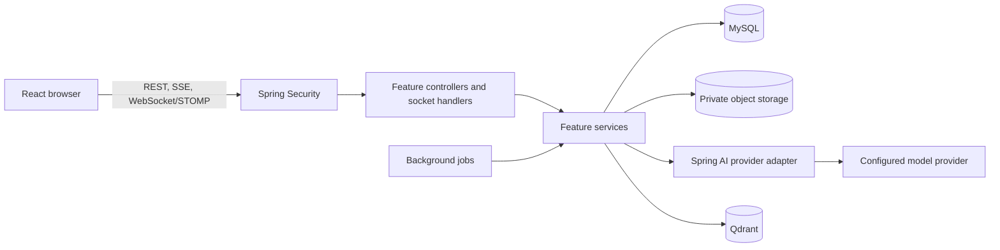

# Architecture and threat model

Source [blueprint pp. 15–17](../StudySphere_Codex_Master_Blueprint.pdf). Phase 00 design.

MySQL owns durable application state, authorization metadata, job status, and event records. Object storage owns file bytes. Qdrant indexes authorized document chunks for retrieval. Feature services control access and refresh derived data. Realtime notifications follow committed writes. Clients fetch missed history from authorized REST endpoints. Background ingestion and reminder workers recover from retries using durable job state and deduplication constraints.

| Layer | Stack and responsibilities |
|---|---|
| Browser | React, TypeScript, Vite, Tailwind CSS, shadcn/ui, Lucide, React Router, TanStack Query, React Hook Form, Zod, Recharts. Use Zustand when justified by shared client-only state. |
| Backend | Java 21, Maven, Spring Boot, Spring Web, Spring Security, Jakarta Bean Validation, Spring Data JPA/Hibernate, Flyway, Spring AI, STOMP, SSE, OpenAPI, Actuator/Micrometer. |
| Infrastructure | Native MySQL 8+ and GitHub Actions in 01, per developer direction. Private S3-compatible storage in 05. Model adapter in 08. Qdrant in 09. Redis is optional for cache or temporary state. Optional WebRTC/LiveKit belongs to 15. |
| Verification | JUnit, Mockito, fresh MySQL integration schemas, Vitest, React Testing Library, and Playwright. Add business-rule and authorization tests as features arrive. |

## Module ownership

Backend feature packages own controllers, services, repositories, entities, DTOs, and tests. Organize under `com.studysphere` with config, common, security, auth, user, academic, planner, focus, room, messaging, matching, resource, ai, document, quiz, flashcard, analytics, achievement, notification, community, and admin. Exam behavior resides in the planner package initially. Compose the dashboard from feature service projections scoped to the principal. Cross-feature calls use explicit services or application events. Keep transport authorization and domain authorization in their respective layers. Access another feature's data through its published interfaces.

Phase 01 establishes the frontend, backend, native database setup, environment example, workflow, and Flyway layout. Frontend feature folders use shared components, layouts, API services, hooks, and types. Document each HTTP contract in OpenAPI before implementing it.

## Threat model

Trust boundaries are the browser, authenticated service, private stores, background workers, and external AI and email providers. Assets include credentials, private profiles and files, chats, study evidence, access controls, and provider budget.

| Threat | Control | Verification phase |
|---|---|---|
| Credential guessing, refresh replay, token theft or CSRF | Password hashing, generic auth failures, rate limits, expiring one-use secrets, atomic refresh and family revocation, cookie security and CSRF, strict origin handling. | 02 · Bad credentials, reuse and races, expiry, logout, reset, CSRF. |
| Cross-account reads and changes | Principal-derived identity, scoped data access, explicit DTO projections, server-side ownership checks, and consistent lookup behavior. | 03–05 · Cross-user profile, dashboard, tasks, and file reads/writes. |
| Malicious upload or exposed file | Private objects, validated size and content type, safe filenames and download headers, restricted downloads, and retried cleanup. | 05 · Invalid formats, lost permission, failed upload, deleted object. |
| Unauthorized messaging or room access | Check connections, blocks, and membership on sends, history, and subscriptions. Recheck revocation for connected sessions. Enforce capacity in a transaction. | 06–07 · Blocked send, unauthorized subscription, reconnect, concurrent joins. |
| Cross-account AI history, prompt injection, cost spikes, unsafe rendering | Scope conversations, treat output as untrusted, restrict read tools, validate schemas, sanitize rendered output, bound requests and context, and support cancellation. | 08 · Isolation, malicious content handling, timeout, cancellation, limit enforcement. |
| Cross-user retrieval, stale vectors, fabricated citations | Constrain Qdrant search by access and recheck current MySQL permissions before using chunks. Queue vector cleanup on deletion or revocation. Map citations from stored source metadata. | 09 · Revoke/delete during retrieval, empty results, citation mapping, cleanup retry. |
| Unapproved or repeated updates | Model proposes changes. Java validates and the student approves. A transaction records approval and creates tasks once. | 11–12 · Invalid, stale, and duplicate approvals, ownership, time budgets, room consent. |
| Excessive privileges, secret exposure, retained user data | Scope admin access, audit moderation, redact sensitive fields, inject secrets through env, define retention and deletion across stores and backups. | 02 onward · Deletion and redaction by module. 14 · Permission matrix, secret scan, and restore rehearsal. |

Phase 14 defines production backup/restore, alerting, moderation runbooks, and load checks. See the [decision register](decisions/README.md) for prerequisites and decision phases.
