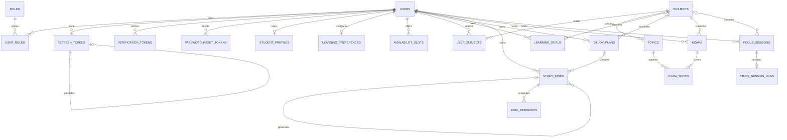

# Initial database design

Source [blueprint pp. 5–8, 11, and 15–22](../StudySphere_Codex_Master_Blueprint.pdf). Logical design for Phases 02–04. Phase 01 provisions a Flyway baseline. Feature tables arrive in the listed phase.

## Phase 02 · Identity

| Table | Key fields and constraints |
|---|---|
| `users` | ID, canonical email unique, password hash, verification timestamp, account status and timestamps. Canonicalize consistently before lookup and insert. |
| `roles`, `user_roles` | Unique role code. Join PK `(user_id, role_id)`. Registration grants STUDENT only. Room and community permissions use future membership models. |
| `refresh_tokens` | Owner, unique SHA-256 refresh and access hashes, family ID, nullable unique predecessor FK, password-authentication time, access/idle/absolute expiries, and consumed/revoked timestamps. Index owner/family and absolute expiry. |
| `verification_tokens`, `password_reset_tokens` | Owner, unique token hash, expiry and consumed timestamp. Index owner and expiry for invalidation and cleanup. |

## Phase 03 · Onboarding and academics

| Table | Key fields and constraints |
|---|---|
| `student_profiles` | User PK/FK, display name, academic details, biography and discoverability flag defaulting to private. Project an explicit public allowlist. |
| `learning_preferences` | User PK/FK, language, IANA timezone, learning styles/skills, optional focus goal added in 04. |
| `availability_slots` | Owner, weekday, local start and end time. Index by owner and day. Require same-day intervals with end after start and reject overlap in a transaction. |
| `subjects`, `topics` | Unique subject slug and topic slug per subject. |
| `user_subjects` | Join PK `(user_id, subject_id)`, optional skill level or interest attributes. |
| `learning_goals` | Owner, optional subject, description, optional target date, status. Index by owner and status. |

The dashboard uses a principal-scoped read model with feature-provided results and honest empty collections.

## Phase 04 · Productivity

| Table | Key fields and constraints |
|---|---|
| `study_plans` | Owner, title, optional subject, optional local date range, version. Index owner and dates. |
| `study_tasks` | Owner, optional plan and parent, title, priority, state, due instant, recurrence rule and zone, occurrence origin and instant, version. Use owner-scoped FKs for plan/parent, unique occurrence per origin and scheduled instant, and an owner/due date index. Disallow cycles. |
| `task_reminders` | Task, scheduled instant, state. Unique task and firing time. Records arrive in 04, scheduled in-app delivery in 13. |
| `exams`, `exam_topics` | Exam owner, subject, title, local exam date and zone, syllabus and goal. Index owner and date. Join PK `(exam_id, topic_id)`. Validate topic subject matches the exam subject. |
| `focus_sessions` | Owner, optional subject, planned focus and break durations, server start, completion timestamp, state and version. Index owner and start. Serialize starts per owner to enforce one active session. |
| `study_session_logs` | Unique focus session FK, recorded duration and timestamp. Derive ownership through the session. |

## Invariants and migrations

- Proposed IDs are database-generated 64-bit integers serialized as decimal strings in APIs. Persist event instants as UTC with microsecond precision. Use local dates with explicit IANA zones where calendar intent matters. Define DST cases at Phase 04 review.
- Rotate a refresh credential atomically under a lock. Mark its predecessor consumed and insert the successor in one transaction. Reuse revokes the family. Reset and deletion revoke refresh credentials.
- V2 introduces the identity tables. It seeds STUDENT and scopes account deletion to the Phase 02 owner records. Passwords use salted PBKDF2-HMAC-SHA256. One-use and session credentials use independent random values and persist only SHA-256 hashes.
- Scope lookups by caller. Use optimistic versions for conflicting user edits. Serialize focus start and atomically finish the session plus its unique log. Retrying completion returns the recorded result.
- Review FK cascades explicitly. Use cascades for owned joins or short-lived token rows where appropriate. Account deletion must account for shared or retained records as modules arrive.
- Assign Flyway version IDs when implementing each phase. Preserve applied migrations and test forward migrations on fresh and existing MySQL schemas. Restrict automatic schema mutation to disposable tests.

## Phase 14 · Moderation and audit

`V22__administration.sql` seeds the `ADMIN` role and creates `admin_reports`, `admin_account_restrictions`, and `admin_audits`. Report identity combines content kind, target ID, and reporter ID. Private-message reports migrate with a null reason and the queue exposes only their metadata. Restrictions are keyed by user ID, carry UTC timestamps, and invalidate refresh token families when applied. Administrative decisions and their audit entries commit in the same transaction. Removing an operator account clears its foreign-key references while retaining its audit entries. Usage queries use the new index on `ai_usage_logs(started_at, provider)`.
